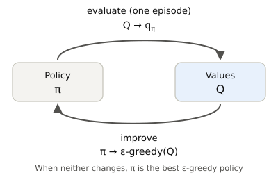
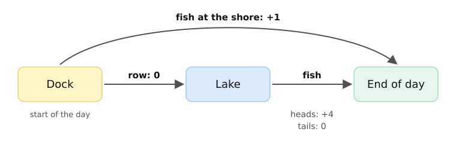

# Reinforcement Learning <br> (DSAI 402)
## Lecture 6: Monte Carlo Control and TD Prediction

**Prof. Mohamed Ghalwash**
<Email v="mghalwash@zewailcity.edu.eg" />
_Zewail City University_

:: note ::

Lecture 6, Monday 2 November 2026

---
layout: top-title
color: sky-light
align: lt
title: Today
---

:: title ::

# Agenda

:: content ::

**Objectives**: you should be able to find a good policy from played episodes with MC control, explain why an $\epsilon$-greedy policy is needed, run the TD(0) update by hand and decide whether DP, MC or TD fits a given problem.

- Finish MC: from prediction to control with $q$ and $\epsilon$-greedy policies
- Why wait for the end of the episode?
- TD(0) prediction: the TD target, the TD error and bootstrapping
- Apply it: the fifth application paper, TD-Gammon
- Practice it: turn six problems into RL problems

<!--
Timing: about 5 minutes for the recap, 35 for MC control, 40 for TD, 10 for the paper, 20 for the practice and 10 for the wrap-up.
If time is tight, skip the slide on what epsilon costs and shorten the paper.
-->

---
layout: section
color: sky
---

# Part 1: Monte Carlo Control

---
layout: top-title
color: light
align: lt
title: Recap
---

:: title ::

# Where We Stopped: MC Prediction

:: content ::

To estimate $v_\pi$, play many episodes with $\pi$ and average the returns seen after each state.

$$
V(S_t) \leftarrow V(S_t) + \frac{1}{N(S_t)}\big( G_t - V(S_t) \big)
$$

- No model, only played episodes.
- In the bridge walk, 60 walks gave rough values and 10,000 walks gave values close to $\tfrac{1}{6}, \tfrac{2}{6}, \dots, \tfrac{5}{6}$.

Prediction tells us **how good** a policy is. Today we first want a **better** policy.

---
layout: top-title
color: light
align: lt
title: Control
---

:: title ::

# What Is MC Control?

:: content ::

| | Prediction | Control |
|---|---|---|
| Question | How good is a given policy $\pi$? | What is the best policy? |
| Output | $v_\pi$ or $q_\pi$ | A policy, as close to $\pi_*$ as we can get |
| With the model (DP) | Policy evaluation | Policy iteration, value iteration |
| From episodes (MC) | MC prediction (last week) | **MC control (today)** |

**MC control** finds a good policy from played episodes, without the model. It repeats two steps:

1. **Evaluate**: play episodes and average their returns to estimate the action values $q(s, a)$.
2. **Improve**: make the policy pick the action with the largest $q(s, a)$, but still try the other actions now and then.

<!--
Control means choosing the actions, i.e. finding the policy. The word comes from control engineering.
Two questions are answered on the next slides: why we estimate q and not v, and how the policy keeps trying every action.
-->

---
layout: top-title
color: light
align: lt
title: Why q
---

:: title ::

# Why Estimate $q$ and Not $v$?

:: content ::

In DP, we improved a policy by acting greedily with respect to $v$:

$$
\pi'(s) = \arg\max_a \sum_{s', r} p(s', r \mid s, a) \left[ r + \gamma\, v(s') \right]
$$

This needs the model $p(s', r \mid s, a)$, which MC does not have.

<v-click>

With $q$, the greedy step needs no model:

$$
\pi'(s) = \arg\max_a q(s, a)
$$

<AdmonitionType type='important'>
Without a model, we learn action values, i.e. one number q(s, a) for each state and action pair.
</AdmonitionType>

</v-click>

<!--
Ask the class: you know V of every square of a new floor, but nobody told you the dice. Can you pick the best move? No, because you do not know where each move takes you. With q you just read the largest number.
-->

---
layout: top-title
color: light
align: lt
title: MC for q
---

:: title ::

# MC Estimation of $q_\pi$

:: content ::

The same idea as last week, with a pair $(s, a)$ in place of a state $s$.

$$
q_\pi(s, a) = \mathbb{E}_\pi\left[ G_t \mid S_t = s, A_t = a \right] \;\approx\; \text{average of the returns after } (s, a)
$$

- A visit is now a visit to the pair, i.e. the agent was in $s$ **and** took $a$.
- First-visit and every-visit work as before.

<v-click>

**The problem**: if $\pi$ is greedy, it always picks the same action in $s$. The other actions are never tried, so their $q$ values are never estimated, and we can never find out that one of them is better.

</v-click>

---
layout: top-title
color: light
align: lt
title: Exploration
---

:: title ::

# Two Ways to Keep Trying Every Action

:: content ::

| | Exploring starts | $\epsilon$-greedy |
|---|---|---|
| Idea | Start each episode from a random pair $(s, a)$ | Most of the time take the best action, sometimes take a random one |
| Needs | Control over where episodes start | Nothing extra |
| Real world | Hard. You cannot start a patient, a plane or a chip at any state you like | Works anywhere the agent can choose its actions |

We use $\epsilon$-greedy from now on.

<!--
Exploring starts work in a simulator where we can set any start, e.g. any board position. In the real world we usually cannot.
-->

---
layout: top-title-two-cols
columns: is-6
align: l-lt-lt
color: light
title: Epsilon greedy
---

:: title ::

# The $\epsilon$-Greedy Policy

:: left ::

With $|\mathcal{A}|$ actions and a small $\epsilon$ (e.g. 0.1):

- With probability $1 - \epsilon$, take the greedy action $\arg\max_a Q(s, a)$.
- With probability $\epsilon$, take an action at random. This random action can also be the greedy one.

$$
\pi(a \mid s) =
\begin{cases}
1 - \epsilon + \dfrac{\epsilon}{|\mathcal{A}|} & \text{greedy } a \\[8pt]
\dfrac{\epsilon}{|\mathcal{A}|} & \text{any other } a
\end{cases}
$$

:: right ::

Example with 2 actions and $\epsilon = 0.1$:

| Action | $Q(s, a)$ | $\pi(a \mid s)$ |
|---|---|---|
| Left | $0.3$ | $0.9 + 0.05 = 0.95$ |
| Right | $-0.1$ | $0.05$ |

Every action keeps a chance of at least $\epsilon / |\mathcal{A}|$, so in every state we visit, every action keeps being tried.

---
layout: top-title-two-cols
columns: is-6
align: l-lt-lt
color: light
title: The big picture
---

:: title ::

# MC Control Is GPI

:: left ::

{width=100%}

:: right ::

After **each episode**:

1. **Evaluate**: update $Q(s, a)$ for every pair in the episode with its return.
2. **Improve**: in every state of the episode, make the policy $\epsilon$-greedy with respect to the new $Q$.

Policy iteration evaluates until the values settle, value iteration evaluates for one sweep and MC control evaluates for one episode.

---
layout: top-title
color: light
align: lt
title: The algorithm
---

:: title ::

# On-Policy First-Visit MC Control

:: content ::

```text
Input: small ε > 0
Set Q(s,a) = 0 and N(s,a) = 0 for every pair
π = ε-greedy with respect to Q

repeat for many episodes:
    play one episode with π:  S_0, A_0, R_1, ..., S_{T-1}, A_{T-1}, R_T
    G = 0
    for t = T-1, T-2, ..., 0:
        G = γ G + R_{t+1}
        if (S_t, A_t) does not appear earlier in the episode:      # first visit
            N(S_t,A_t) = N(S_t,A_t) + 1
            Q(S_t,A_t) = Q(S_t,A_t) + (G − Q(S_t,A_t)) / N(S_t,A_t)
            π(S_t) = ε-greedy with respect to Q(S_t, ·)

return π, Q
```

- The only changes from last week: $Q(s, a)$ in place of $V(s)$, and the policy changes after every episode.
- **On-policy**: the policy that plays the episodes is the same policy that we improve.

---
layout: top-title
color: emerald-light
align: lt
title: Example
---

:: title ::

# Example: The Fishing Trip

:: content ::

{width=78% .mx-auto}

- Each day is one episode, with $\gamma = 1$. At the lake, a coin decides the catch.
- The agent does not know the coin. It only goes fishing and counts its fish.

**Which choice is better at the dock?**

<v-click>

$q(\text{dock}, \text{shore}) = 1$ and $q(\text{dock}, \text{row}) = 0 + \tfrac{1}{2} \cdot 4 + \tfrac{1}{2} \cdot 0 = 2$. Rowing is better, but the agent has to find this out from its own days.

</v-click>

<!--
The lake has only one action, so the only real choice is at the dock.
Q(lake, fish) gets the same returns as Q(dock, row) here, because rowing gives 0 and gamma = 1.
-->

---
layout: top-title
color: emerald-light
align: lt
title: Example
---

:: title ::

# Pure Greedy Gets Stuck

:: content ::

MC control with no exploration. All $Q$ values start at 0 and ties are broken at random. After each day, $Q(\text{dock}, a)$ is the average of the returns after choosing $a$.

<v-clicks>

| Day | Choice at the dock | Coin | Return | $Q(\text{dock}, \text{shore})$ | $Q(\text{dock}, \text{row})$ |
|---|---|---|---|---|---|
| 1 | row (a tie, picked at random) | tails | 0 | 0 | 0 |
| 2 | shore (a tie, picked at random) | | 1 | 1 | 0 |
| 3 | shore (greedy, since 1 > 0) | | 1 | 1 | 0 |
| 4, 5, ... | shore (greedy) | | 1 | 1 | 0 |

</v-clicks>

<v-click>

One unlucky coin on day 1, and the agent never rows again. In 100,000 simulated runs, pure greedy settles on rowing in only 1 run out of 3.

</v-click>

<!--
Why 1 out of 3: at a tie, half the time the agent picks the shore and is stuck there for good. The other half it rows. Heads makes rowing the greedy choice for good, and tails brings it back to a tie. So p = 1/2 (1/2 + 1/2 p), which gives p = 1/3.
-->

---
layout: top-title
color: emerald-light
align: lt
title: Example
---

:: title ::

# $\epsilon$-Greedy Keeps Trying

:: content ::

Now with $\epsilon = 0.1$. Days 1 to 3 go as before, so $Q(\text{dock}, \text{shore}) = 1$ and $Q(\text{dock}, \text{row}) = 0$. On day 4, the agent makes a random move.

<v-clicks>

| Day | Choice at the dock | Coin | Return | $Q(\text{dock}, \text{shore})$ | $Q(\text{dock}, \text{row})$ |
|---|---|---|---|---|---|
| 4 | row (random move) | heads | 4 | 1 | $(0 + 4)/2 = 2$ |
| 5 | row (greedy, since 2 > 1) | tails | 0 | 1 | $(0 + 4 + 0)/3 \approx 1.33$ |
| 6 | row (greedy, since 1.33 > 1) | heads | 4 | 1 | $(0 + 4 + 0 + 4)/4 = 2$ |

</v-clicks>

<v-click>

The random moves keep testing both choices, so both averages move toward the true values, 1 and 2. In 100,000 simulated runs, 88% of runs row after 100 days, and all but 7 row after 1,000 days.

</v-click>

<!--
The average for rowing can still dip below 1 after a few tails. Then the agent fishes at the shore for a while, until a random move tries the lake again.
The simulation uses on-policy first-visit MC control with sample averages, Q starting at 0 and fixed random seeds.
-->

---
layout: top-title
color: light
align: lt
title: The cost of epsilon
---

:: title ::

# What Does $\epsilon$ Cost?

:: content ::

- The agent keeps making random moves, so it loses a little. On the fishing trip with $\epsilon = 0.1$, it still fishes at the shore on 5% of the days. It catches $0.95 \times 2 + 0.05 \times 1 = 1.95$ fish per day on average, not 2.
- MC control finds the best policy **among $\epsilon$-greedy policies**, not the best policy overall.
- The usual fix in practice: shrink $\epsilon$ slowly over time, or play the greedy policy once learning is done.

<AdmonitionType type='tip'>
Next lecture, Q-learning learns about the greedy policy while it plays an exploring policy. That is called off-policy learning.
</AdmonitionType>

---
layout: section
title: Questions
class: text-center
---

# Learn More

[Course Homepage](https://github.com/m-fakhry/DSAI-402-RL)
