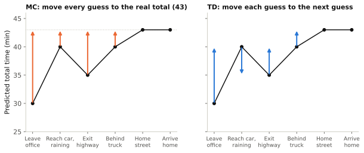
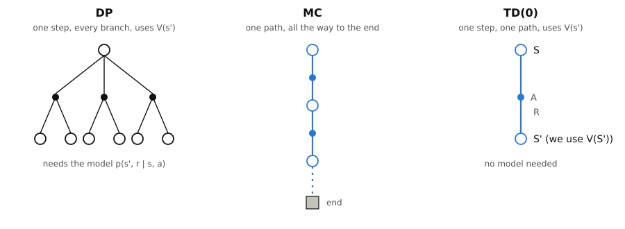
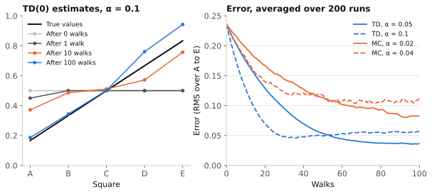

# Reinforcement Learning <br> (DSAI 402)
## Lecture 6: Monte Carlo Control and TD Prediction

**Prof. Mohamed Ghalwash**
<Email v="mghalwash@zewailcity.edu.eg" />
_Zewail City University_

:: note ::

Lecture 7, Monday 16 November 2026

---
layout: section
color: sky
---

# Part 2: Temporal Difference Prediction

---
layout: top-title
color: light
align: lt
title: Why wait
---

:: title ::

# Driving Home

:: content ::

| Situation | Minutes so far | Guess of minutes left | Guess of total |
|---|---|---|---|
| Leave office | 0 | 30 | 30 |
| Reach car, it is raining | 5 | 35 | 40 |
| Exit highway | 20 | 15 | 35 |
| Stuck behind a truck | 30 | 10 | 40 |
| Enter home street | 40 | 3 | 43 |
| Arrive home | 43 | 0 | 43 |

When you see the rain at minute 5, do you wait until you get home to say "my first guess was too low"?

<!--
This is Example 6.1 of Sutton and Barto. You guess how long the drive home will take and change your guess as things happen.
Ask the class before the next slide. Most people change their guess right away. That is the idea of TD.
-->

---
layout: top-title
color: light
align: lt
title: Why wait
---

:: title ::

# MC Waits, TD Does Not

:: content ::

{width=86% .mx-auto}

- **MC** moves every guess toward the real total, 43. It can do this only after you arrive.
- **TD** moves each guess toward the next guess. It can do this one step later.

---
layout: top-title
color: light
align: lt
title: The update
---

:: title ::

# From MC to TD(0)

:: content ::

MC with a fixed step size $\alpha$:

$$
V(S_t) \leftarrow V(S_t) + \alpha \big[\, G_t - V(S_t) \,\big]
$$

TD(0): replace the full return $G_t$ by one real reward plus the current guess of the next state.

$$
V(S_t) \leftarrow V(S_t) + \alpha \big[\, \underbrace{R_{t+1} + \gamma\, V(S_{t+1})}_{\text{TD target}} - V(S_t) \,\big]
$$

$$
\delta_t = R_{t+1} + \gamma\, V(S_{t+1}) - V(S_t) \qquad \text{(the TD error)}
$$

- It has the same shape as before: new = old + step size × (target − old).
- Using a guess like $V(S_{t+1})$ to update another guess is called **bootstrapping**.
- The value of the end state is always 0.

<!--
Why the target makes sense: v_pi(s) = E[R_{t+1} + gamma v_pi(S_{t+1}) | S_t = s]. This is the Bellman equation for v_pi from lecture 4. DP takes this expectation with the model. TD takes one sample of it.
-->

---
layout: top-title
color: light
align: lt
title: By hand
---

:: title ::

# TD(0) on the Bridge Walk

:: content ::

Every value starts at 0.5, the river and 🏠 are worth 0, $\alpha = 0.1$ and $\gamma = 1$. Walk 1 from last week was C B C D E 🏠.

| Step | Reward | TD target | Update |
|---|---|---|---|
| C → B | 0 | $0 + 0.5 = 0.5$ | $V(C) = 0.5 + 0.1(0.5 - 0.5) = 0.5$ |
| B → C | 0 | $0 + 0.5 = 0.5$ | $V(B) = 0.5$ |
| C → D | 0 | $0.5$ | $V(C) = 0.5$ |
| D → E | 0 | $0.5$ | $V(D) = 0.5$ |
| E → 🏠 | $+1$ | $1 + 0 = 1$ | $V(E) = 0.5 + 0.1(1 - 0.5) = 0.55$ |

<v-click>

Only $V(E)$ changed. MC with the same $\alpha$ moves C, B, D and E toward the return 1.

</v-click>

<!--
MC with alpha = 0.1, first-visit: V(B), V(C), V(D), V(E) all become 0.5 + 0.1(1 - 0.5) = 0.55. Every-visit updates C twice, so V(C) = 0.55 + 0.1(1 - 0.55) = 0.595.
-->

---
layout: top-title
color: light
align: lt
title: Your turn
---

:: title ::

# Two More Walks

:: content ::

Start from the values after walk 1, i.e. 0.5 everywhere except $V(E) = 0.55$.

**Walk 2**: C B A 🌊 

| | $V(A)$ | $V(B)$ | $V(C)$ | $V(D)$ | $V(E)$ |
|---|---|---|---|---|---|
| After walk 2 | <span v-click="1" style="background: #fff3b0; padding: 0.1em 0.5em; border-radius: 0.3em;">0.45</span> | <span v-click="1" style="background: #fff3b0; padding: 0.1em 0.5em; border-radius: 0.3em;">0.5</span> | <span v-click="1" style="background: #fff3b0; padding: 0.1em 0.5em; border-radius: 0.3em;">0.5</span> | 0.5 | 0.55 |

**Walk 3**: C D E 🏠

| | $V(A)$ | $V(B)$ | $V(C)$ | $V(D)$ | $V(E)$ |
|---|---|---|---|---|---|
| After walk 3 | <span v-click="1">0.45</span> | <span v-click="1">0.5</span> | <span v-click="2" style="background: #fff3b0; padding: 0.1em 0.5em; border-radius: 0.3em;">0.5</span> | <span v-click="2" style="background: #fff3b0; padding: 0.1em 0.5em; border-radius: 0.3em;">0.505</span> | <span v-click="2" style="background: #fff3b0; padding: 0.1em 0.5em; border-radius: 0.3em;">0.595</span> |

<v-click at="3">

In walk 3, $V(D)$ went up because $V(E)$ had gone up in walk 1. Good news moves back at most one square per walk.

</v-click>

<!--
Walk 2: C to B and B to A give TD errors of 0. A to the river: V(A) = 0.5 + 0.1(0 + 0 - 0.5) = 0.45.
Walk 3: C to D: 0.5 + 0.1(0 + 0.5 - 0.5) = 0.5. D to E: 0.5 + 0.1(0 + 0.55 - 0.5) = 0.505. E to home: 0.55 + 0.1(1 + 0 - 0.55) = 0.595.
-->

---
layout: top-title
color: light
align: lt
title: The algorithm
---

:: title ::

# TD(0) Prediction

:: content ::

```text
Input: policy π, step size α in (0, 1]
Set V(s) to any value, e.g. 0, for every state s. V of the end state must be 0

repeat for many episodes:
    S = start state
    repeat until S is the end:
        A = action chosen by π in S
        take A, see R and S'
        V(S) = V(S) + α [ R + γ V(S') − V(S) ]
        S = S'

return V   (close to v_π)
```

- It updates **after every step**, not at the end of the episode.
- It works for tasks that **never end** (with $\gamma < 1$), because it never needs $G_t$.

---
layout: top-title
color: light
align: lt
title: DP, MC or TD
---

:: title ::

# One Backup in DP, MC and TD

:: content ::

{width=68% .mx-auto}

| | DP | MC | TD(0) |
|---|---|---|---|
| Needs the model | Yes | No | No |
| Bootstraps (uses $V(s')$) | Yes | No | Yes |
| Waits for the end of the episode | No | Yes | No |

<!--
TD samples one real path like MC, so it needs no model. It bootstraps like DP, so it does not wait for the end.
-->

---
layout: top-title-two-cols
columns: is-6
align: l-lt-lt
color: light
title: Bias and variance
---

:: title ::

# Which Target Is Better?

:: left ::

**MC target**: $G_t$

- No bias. $G_t$ is a real sample of $v_\pi(S_t)$.
- High variance. It depends on every random step until the end.

**TD target**: $R_{t+1} + \gamma V(S_{t+1})$

- Biased while $V$ is still wrong.
- Low variance. It depends on one random step only.

:: right ::

| | MC | TD |
|---|---|---|
| Bias | None | Yes, it shrinks as $V$ improves |
| Variance | High | Low |
| Learns during the episode | No | Yes |
| Tasks that never end | No | Yes |

In practice TD usually learns faster. The next slide shows this on the bridge walk.

---
layout: top-title-two-cols
columns: is-7
align: l-lt-lt
color: light
title: The bridge walk again
---

:: title ::

# MC vs TD on the Bridge Walk

:: left ::

{width=100%}

:: right ::

- **Left**: after one walk that ended in 🌊, only $V(A)$ moved. After 100 walks, A, B and C are close to the true values, but D and E are still about 0.1 too high.
- **Right**: after the first few walks, TD has a lower error than MC for every step size we tried.
- A larger $\alpha$ learns faster at first, but the error stops going down, because each update keeps jumping.

<!--
All values start at 0.5, gamma = 1. MC here is every-visit MC with a fixed step size. The error is the root mean square error over A to E, averaged over 200 runs with fixed seeds.
This is the setup of Sutton and Barto, Example 6.2.
-->

---
layout: top-title
color: light
align: lt
title: Lab preview
---

:: title ::

# TD(0) in Gymnasium

:: content ::

We reuse the `BridgeWalk` environment from last week.

```python
import numpy as np

env = BridgeWalk()
alpha, gamma = 0.01, 1.0
V = np.full(7, 0.5)
V[0] = V[6] = 0.0                       # river and home

for walk in range(5000):
    s, _ = env.reset()
    done = False
    while not done:
        s2, r, terminated, truncated, _ = env.step(0)
        target = r + (0.0 if terminated else gamma * V[s2])
        V[s] += alpha * (target - V[s])  # TD(0) update
        s, done = s2, terminated or truncated
```

Try it: run TD(0) and MC on the same walks with the same step sizes and compare their errors.

<!--
With alpha = 0.01 and 5,000 walks, the values come within about 0.04 of the true values.
-->

---
layout: top-title
color: light
align: lt
title: Choosing a method
---

:: title ::

# DP, MC or TD?

:: content ::

Ask these questions in order.

| Question | If yes | If no |
|---|---|---|
| 1. Do we know the model $p(s', r \mid s, a)$ and is the state space small? | DP | Learn from experience. Go to 2 |
| 2. Does every episode end? | Go to 3 | TD only |
| 3. Are the episodes short? | MC works well, and so does TD | TD, since MC learns slowly |

<AdmonitionType type='important'>
If the state space is too large for a table, none of these methods work as they are. That is the second half of the course.
</AdmonitionType>

---
layout: top-title
color: light
title: Apply it
---

:: title ::

# Questions for the TD-Gammon Paper

:: content ::

1. The network outputs a guess of how the game will end. Which quantity from today is this, $v_\pi$ or $q_\pi$? Of which policy?
2. The reward comes only at the end of the game. Why can TD still learn from every move?
3. Backgammon has dice. Does the TD update need the dice probabilities?
4. To pick a move, TD-Gammon looks at the board after each legal move and takes the best one. Is it using a model? Which part of the game does it need to know?
5. Why does TD-Gammon use a neural network and not a table?
6. It learned by playing against itself. How is this like the GPI loop of MC control?

<!--
Answers.
1. A state value, i.e. v of the current self-play policy. It is read as the expected result of the game, e.g. the chance of winning.
2. Each move's guess is moved toward the guess after the next move. The final reward moves the last guess, and over many games the good news moves back.
3. No. The dice only decide which positions it sees.
4. It needs the rules, i.e. which board each move leads to, but not the dice. This is a value of the position after the move, which some books call an afterstate.
5. There are far too many board positions for a table. We come back to this in week 9.
6. Evaluate: TD updates the values. Improve: the player picks the best move under the new values. The two happen at every move.
-->

---
layout: section
color: sky
---

# Practice: Name the Parts

---
layout: top-title
color: light
align: lt
title: Practice
---

:: title ::

# Turn Each Problem Into an RL Problem

:: content ::

Work in pairs. For each problem on the next slides, write:

| Part | Question |
|---|---|
| States | What does the agent need to know to decide? |
| Actions | What can it choose? |
| Reward | What does it get, and when? |
| Episodes | Does the task end? |
| Model | Do we know where each action leads, and with what chance? |
| Method | DP, MC or TD? Why? |

You have 2 minutes per problem. Then we reveal the answer one part at a time.

<!--
Students only know TD prediction so far. For control problems where TD fits, "TD" is enough as an answer. TD control comes in the next lecture.
-->

---
layout: top-title
color: light
align: lt
title: Practice
---

:: title ::

# Problem 1: The Shop

:: content ::

A small shop orders new stock at the end of each day. The owner knows the chance of each level of demand from years of sales. The shop can hold at most 20 units.

- **States**: <span v-click="1" style="background: #fff3b0; padding: 0.1em 0.5em; border-radius: 0.3em;">units in stock, from 0 to 20</span>
- **Actions**: <span v-click="2" style="background: #fff3b0; padding: 0.1em 0.5em; border-radius: 0.3em;">how many units to order</span>
- **Reward**: <span v-click="3" style="background: #fff3b0; padding: 0.1em 0.5em; border-radius: 0.3em;">profit minus storage cost, every day</span>
- **Episodes**: <span v-click="4" style="background: #fff3b0; padding: 0.1em 0.5em; border-radius: 0.3em;">never end, so we use $\gamma < 1$</span>
- **Model**: <span v-click="5" style="background: #fff3b0; padding: 0.1em 0.5em; border-radius: 0.3em;">known, from the chances of each demand level</span>
- **Method**: <span v-click="6" style="background: #fff3b0; padding: 0.1em 0.5em; border-radius: 0.3em;">DP</span>

<v-click at="7">

**Why DP?** We know where each order leads and there are only 21 states. DP does not need episodes that end, as long as $\gamma < 1$.

</v-click>

<!--
The prices and costs are known too, so the reward of each order is known. This is the classic inventory problem.
-->

---
layout: top-title
color: light
align: lt
title: Practice
---

:: title ::

# Problem 2: The Warehouse Robot

:: content ::

A robot moves on a known floor map to reach a shelf. Every move goes exactly where it is told.

- **States**: <span v-click="1" style="background: #fff3b0; padding: 0.1em 0.5em; border-radius: 0.3em;">the robot's square</span>
- **Actions**: <span v-click="2" style="background: #fff3b0; padding: 0.1em 0.5em; border-radius: 0.3em;">up, down, left, right</span>
- **Reward**: <span v-click="3" style="background: #fff3b0; padding: 0.1em 0.5em; border-radius: 0.3em;">$-1$ for each move</span>
- **Episodes**: <span v-click="4" style="background: #fff3b0; padding: 0.1em 0.5em; border-radius: 0.3em;">end when the robot reaches the shelf</span>
- **Model**: <span v-click="5" style="background: #fff3b0; padding: 0.1em 0.5em; border-radius: 0.3em;">known, from the map, and every move is certain</span>
- **Method**: <span v-click="6" style="background: #fff3b0; padding: 0.1em 0.5em; border-radius: 0.3em;">DP</span>

<v-click at="7">

**Why DP?** The map tells us exactly where each move leads, and there are few squares. This is like our grid from lectures 1 to 4.

</v-click>

<!--
A shortest path search, e.g. breadth-first search, also solves it. That makes a good non-RL baseline. Not every problem needs RL.
-->

---
layout: top-title
color: light
align: lt
title: Practice
---

:: title ::

# Problem 3: Tic-Tac-Toe

:: content ::

An agent plays tic-tac-toe against an opponent whose style it does not know.

- **States**: <span v-click="1" style="background: #fff3b0; padding: 0.1em 0.5em; border-radius: 0.3em;">the board</span>
- **Actions**: <span v-click="2" style="background: #fff3b0; padding: 0.1em 0.5em; border-radius: 0.3em;">an empty cell</span>
- **Reward**: <span v-click="3" style="background: #fff3b0; padding: 0.1em 0.5em; border-radius: 0.3em;">$+1$ win, $-1$ loss, $0$ draw, only at the end</span>
- **Episodes**: <span v-click="4" style="background: #fff3b0; padding: 0.1em 0.5em; border-radius: 0.3em;">end after a few moves</span>
- **Model**: <span v-click="5" style="background: #fff3b0; padding: 0.1em 0.5em; border-radius: 0.3em;">unknown, because we do not know how the opponent plays</span>
- **Method**: <span v-click="6" style="background: #fff3b0; padding: 0.1em 0.5em; border-radius: 0.3em;">MC</span>

<v-click at="7">

**Why MC?** Games are short, the reward comes at the end and the boards fit in a table. TD also works.

</v-click>

<!--
There are only a few thousand boards. Sutton and Barto use this game in Section 1.5 and learn it with a TD update.
-->

---
layout: top-title
color: light
align: lt
title: Practice
---

:: title ::

# Problem 4: The Office Thermostat

:: content ::

A thermostat controls the temperature of an office all year, day and night. There is no reset.

- **States**: <span v-click="1" style="background: #fff3b0; padding: 0.1em 0.5em; border-radius: 0.3em;">room and outside temperature (in bins), time of day</span>
- **Actions**: <span v-click="2" style="background: #fff3b0; padding: 0.1em 0.5em; border-radius: 0.3em;">heat, cool, off</span>
- **Reward**: <span v-click="3" style="background: #fff3b0; padding: 0.1em 0.5em; border-radius: 0.3em;">minus energy cost minus discomfort, every step</span>
- **Episodes**: <span v-click="4" style="background: #fff3b0; padding: 0.1em 0.5em; border-radius: 0.3em;">never end, so we use $\gamma < 1$</span>
- **Model**: <span v-click="5" style="background: #fff3b0; padding: 0.1em 0.5em; border-radius: 0.3em;">unknown, because we do not know how the building heats and cools</span>
- **Method**: <span v-click="6" style="background: #fff3b0; padding: 0.1em 0.5em; border-radius: 0.3em;">TD</span>

<v-click at="7">

**Why TD?** The task never ends, so MC never gets a return to average. TD learns after every step.

</v-click>

<!--
Ask the class what goes wrong if the reward leaves out discomfort: the agent learns to keep everything off.
Why the outside temperature? Without it, the same room temperature can lead to very different next temperatures, so the state would not be Markov.
-->

---
layout: top-title
color: light
align: lt
title: Practice
---

:: title ::

# Problem 5: The Field Sensor

:: content ::

A sensor in a farm field collects readings. Every minute it decides whether to send them now or wait for a stronger signal. Sending on a weak signal uses more battery. The episode ends when the battery is empty, after about a month.

- **States**: <span v-click="1" style="background: #fff3b0; padding: 0.1em 0.5em; border-radius: 0.3em;">battery level, readings waiting, signal strength (in bins)</span>
- **Actions**: <span v-click="2" style="background: #fff3b0; padding: 0.1em 0.5em; border-radius: 0.3em;">send now, wait</span>
- **Reward**: <span v-click="3" style="background: #fff3b0; padding: 0.1em 0.5em; border-radius: 0.3em;">$+1$ for each reading sent</span>
- **Episodes**: <span v-click="4" style="background: #fff3b0; padding: 0.1em 0.5em; border-radius: 0.3em;">end, but only after tens of thousands of steps</span>
- **Model**: <span v-click="5" style="background: #fff3b0; padding: 0.1em 0.5em; border-radius: 0.3em;">unknown, because we do not know how the signal and the battery change</span>
- **Method**: <span v-click="6" style="background: #fff3b0; padding: 0.1em 0.5em; border-radius: 0.3em;">TD</span>

<v-click at="7">

**Why TD?** MC would wait a whole month for each return, and that return adds up tens of thousands of random steps. TD learns every minute.

</v-click>

<!--
MC works in theory, which makes this one good for discussion. A month has about 43,000 minutes, so one return adds up about 43,000 random steps.
-->

---
layout: top-title
color: light
align: lt
title: Practice
---

:: title ::

# Problem 6: The Self-Driving Car

:: content ::

A car drives in a city using its camera images.

- **States**: <span v-click="1" style="background: #fff3b0; padding: 0.1em 0.5em; border-radius: 0.3em;">the camera images</span>
- **Actions**: <span v-click="2" style="background: #fff3b0; padding: 0.1em 0.5em; border-radius: 0.3em;">steering and speed</span>
- **Reward**: <span v-click="3" style="background: #fff3b0; padding: 0.1em 0.5em; border-radius: 0.3em;">progress along the route minus crashes</span>
- **Episodes**: <span v-click="4" style="background: #fff3b0; padding: 0.1em 0.5em; border-radius: 0.3em;">end at the end of each trip</span>
- **Model**: <span v-click="5" style="background: #fff3b0; padding: 0.1em 0.5em; border-radius: 0.3em;">unknown, because traffic and people are hard to predict</span>
- **Method**: <span v-click="6" style="background: #fff3b0; padding: 0.1em 0.5em; border-radius: 0.3em;">none of them yet</span>

<v-click at="7">

**Why none?** There are far too many camera images for a table, and the car almost never sees the same image twice. We need function approximation, which comes in week 9.

</v-click>

<!--
The actions are also continuous. Policy gradients and actor-critic handle this later in the course.
Ask whether we want the car to learn by crashing in the real world. This is why simulators matter.
-->

---
layout: top-title
color: light
align: lt
title: Reflect
---

:: title ::

# Debrief

:: content ::

- Which part was the hardest to write? <span v-click="1" style="background: #fff3b0; padding: 0.1em 0.5em; border-radius: 0.3em;">usually the reward, because a bad reward teaches the wrong thing</span>

- When did DP win? <span v-click="2" style="background: #fff3b0; padding: 0.1em 0.5em; border-radius: 0.3em;">when the model was known and the state space was small</span>

- When did MC lose to TD? <span v-click="3" style="background: #fff3b0; padding: 0.1em 0.5em; border-radius: 0.3em;">when episodes never end or are very long</span>

- What broke all three methods? <span v-click="4" style="background: #fff3b0; padding: 0.1em 0.5em; border-radius: 0.3em;">too many states for a table</span>

- Pick your own project. Which of the six problems does it look like? <span v-click="5" style="background: #fff3b0; padding: 0.1em 0.5em; border-radius: 0.3em;">bring the answer to the week 7 milestone</span>

---
layout: top-title
color: light
align: lt
title: Avoid these
---

:: title ::

# Common Mistakes

:: content ::

- Using $V$ for control without a model. Without $p(s', r \mid s, a)$, you need $Q(s, a)$ to pick an action.
- Using a fully greedy policy in MC control. Some actions are never tried.
- Forgetting that $V$ of the end state is 0 in the TD target.
- Updating $V(S_{t+1})$ instead of $V(S_t)$. The TD update changes the state we **left**.
- Treating the TD target as the truth. It is built from a guess, so it is biased while $V$ is wrong.
- Using a large $\alpha$ and expecting the error to keep going down.
- Using MC on a task whose episodes may never end.

---
layout: top-title
color: light
align: lt
title: Your turn
---

:: title ::

# Practice Check

:: content ::

1. Why does MC control estimate $q$ and not $v$?
2. With 4 actions and $\epsilon = 0.2$, what is the chance of the greedy action? Of each other action?
3. $V(B) = 0.4$, $V(C) = 0.6$, $\alpha = 0.5$, $\gamma = 1$. The agent moves from B to C with reward 0. Compute the TD error and the new $V(B)$.
4. Which target is biased, the MC return or the TD target? Which one has more variance?
5. A task never ends and we do not know the model. Which of DP, MC and TD(0) can we use?
6. After walk 1 of the bridge walk (C B C D E 🏠) with every value at 0.5 and $\alpha = 0.1$, which values does TD change? Which values does MC change?

<!--
Answers.
1. To act greedily with v you need the model to see where each action leads. With q you just take the largest q(s, a).
2. Greedy: 1 - 0.2 + 0.2/4 = 0.85. Each other action: 0.2/4 = 0.05.
3. TD error = 0 + 0.6 - 0.4 = 0.2. New V(B) = 0.4 + 0.5(0.2) = 0.5.
4. The TD target is biased because it uses V(S'). The MC return has more variance because it depends on every step until the end.
5. TD(0) only. DP needs the model and MC needs episodes that end.
6. TD changes only V(E), to 0.55. MC changes B, C, D and E, which all move toward the return 1.
-->

---
layout: grid-cards
cols: 4
---

:: card-1 ::
#### Action values
Without a model, learn $q(s, a)$ so the greedy step is $\arg\max_a q(s, a)$

:: card-2 ::
#### $\epsilon$-greedy
Mostly take the best action, sometimes a random one, so every action keeps being tried

:: card-3 ::
#### MC control
GPI with one episode of evaluation before each improvement

:: card-4 ::
#### On-policy
The policy that plays is the policy that we improve

:: card-5 ::
#### TD target
$R_{t+1} + \gamma V(S_{t+1})$, i.e. one real reward plus a guess

:: card-6 ::
#### TD error
$\delta_t = R_{t+1} + \gamma V(S_{t+1}) - V(S_t)$

:: card-7 ::
#### Bootstrapping
Update a guess from another guess. DP and TD do it, MC does not

:: card-8 ::
#### MC vs TD
MC has no bias but high variance. TD has some bias, low variance and does not wait for the end

---
layout: top-title
color: sky-light
align: lt
title: Before next week
---

:: title ::

# Before We Meet Again

:: content ::

1. **Read Sutton and Barto, Sections 5.3, 5.4, 6.1 and 6.2**.
2. **Write a short response to the TD-Gammon paper**, with a focus on the questions on the slide.
3. **Read the elevator paper for week 7**: Crites and Barto, Improving Elevator Performance Using Reinforcement Learning, NeurIPS 8 (1996).
4. **Project milestone in week 7**: MDP specification, Gymnasium environment and non-RL baseline results.

Next lecture: TD control, i.e. SARSA and Q-learning.

<AdmonitionType type='tip'>
Fill in today's six-row table for your own project. It is most of your week 7 MDP specification.
</AdmonitionType>

