# Speech Recognition   (DSAI 456)
## Lecture 6: HMMs and GMMs by Hand

**Prof. Mohamed Ghalwash**
<Email v="mghalwash@zewailcity.edu.eg" />
_Zewail City University_

:: note ::

Lecture 6, Monday 2 November 2026.

---
layout: top-title
color: sky-light
align: lt
title: Today
---

:: title ::

# Agenda

:: content ::

**Objectives**: by the end of this lecture you should be able to fill a forward and a Viterbi trellis by hand for an HMM you have not seen before, score a frame with a Gaussian and with a mixture, run one EM step by hand, and explain how a GMM-HMM is trained.

- **Part 1, HMMs by hand**: forward, Viterbi and backtrace on new examples
- **Part 2, GMMs by hand**: human k-means, Gaussian scores, shares, EM, and training the GMM-HMM
- **Part 3, Putting it together**: decoding, the limits of the GMM, and an exam-style problem

<AdmonitionType type='important'>
Most of today is practice: every <strong>Practice</strong> slide is done in pairs, on paper, before the answer appears. Keep a calculator ready.
</AdmonitionType>

---
layout: top-title
color: light
align: lt
title: HMM toolkit
---

:: title ::

# Recap: Forward and Viterbi Side by Side

:: content ::

| | **Forward** (sum) | **Viterbi** (max) |
|---|---|---|
| A cell holds | $\alpha_t(j)$: **sum** over all paths that end in $j$ at time $t$ | $\delta_t(j)$: probability of the **best** such path |
| Start | $\alpha_1(j) = \pi_j\, b_j(x_1)$ | $\delta_1(j) = \pi_j\, b_j(x_1)$ |
| Step | $\alpha_t(j) = \big[\sum_i \alpha_{t-1}(i)\, a_{ij}\big]\, b_j(x_t)$ | $\delta_t(j) = \big[\max_i \delta_{t-1}(i)\, a_{ij}\big]\, b_j(x_t)$, and store $\psi_t(j)$ |
| End | $P(X \mid \lambda) = \alpha_T(N)$ | $P^* = \delta_T(N)$, then backtrace |
| Answers | how likely is this word? | which frames belong to which state? |

<v-click>

**One cell, four moves**: (1) find the arrows that come **into** the cell, (2) multiply each predecessor by its arrow, (3) **add** them (forward) or **keep the largest** (Viterbi), (4) multiply by the emission of the **current** frame.

</v-click>

<!--
Point at this slide whenever a student is stuck in Part 1: almost every mistake is one of the four moves done in the wrong order, or the emission of the previous frame used instead of the current one.
-->

---
layout: section
title: HMMs by hand
---

# Part 1

## HMMs by Hand

Forward, Viterbi and backtrace on new examples

---
layout: top-title
color: amber-light
align: lt
title: Practice - score a path
---

:: title ::

# Practice 1: Score One Path (3 min)

:: content ::

Same *salaam* model as Lectures 4 and 5: $\pi = (1, 0)$; $a_{ss} = 0.5$, $a_{sa} = 0.5$, $a_{aa} = 1$; /s/ emits h 0.8, v 0.2; /a/ emits h 0.2, v 0.8. **New sounds**: $X = (h, h, v, v)$.

Compute $P(X, Q \mid \lambda)$ for each state sequence $Q$:

**a.** s s a a &nbsp;&nbsp; **b.** s a a a &nbsp;&nbsp; **c.** s a s a &nbsp;&nbsp; **d.** a a a a

<v-click>

| $Q$ | start × emit, then (move × emit) for each frame | $P(X, Q)$ |
|---|---|---|
| s s a a | $1 \cdot 0.8 \;\cdot\; 0.5 \cdot 0.8 \;\cdot\; 0.5 \cdot 0.8 \;\cdot\; 1 \cdot 0.8$ | **0.1024** |
| s a a a | $1 \cdot 0.8 \;\cdot\; 0.5 \cdot 0.2 \;\cdot\; 1 \cdot 0.8 \;\cdot\; 1 \cdot 0.8$ | 0.0512 |
| s a s a | the move /a/ → /s/ has probability 0 | 0 |
| a a a a | $\pi_a = 0$: a word cannot start in /a/ | 0 |

</v-click>

<v-click>

A path is **one long product**. A single zero anywhere (in $\pi$, $A$ or $B$) kills the whole path.

</v-click>

---
layout: top-title-two-cols
color: amber-light
columns: is-6
align: l-lt-ct
title: Practice - forward and Viterbi
clicks: 5
---

:: title ::

# Practice 2: Forward and Viterbi Together (8 min)

:: left ::

Same model, $X = (h, h, v, v)$. Fill **two** numbers per cell: $\alpha$ (add) and $\delta$ (keep the larger). Then backtrace.

<v-clicks>

- **$t = 1$** (h): $\alpha_1 = \delta_1 = (0.8,\ 0)$
- **$t = 2$** (h): $\alpha_2(s) = 0.8 \cdot 0.5 \cdot 0.8 = 0.32$; $\;\alpha_2(a) = \big[\alpha_1(s)\, a_{sa} + \alpha_1(a)\, a_{aa}\big]\, b_a(h) = (0.8 \cdot 0.5 + 0 \cdot 1) \cdot 0.2 = 0.08$. Only one real way in, so $\delta_2 = \alpha_2$.
- **$t = 3$** (v): $\alpha_3(s) = 0.032$; $\;\alpha_3(a) = (0.32 \cdot 0.5 + 0.08 \cdot 1) \cdot 0.8 = 0.192$; $\;\delta_3(a) = \max(0.16,\ 0.08) \cdot 0.8 = 0.128$, from /s/
- **$t = 4$** (v): $\alpha_4(a) = (0.032 \cdot 0.5 + 0.192 \cdot 1) \cdot 0.8 = \mathbf{0.1664}$; $\;\delta_4(a) = \max(0.016,\ 0.128) \cdot 0.8 = \mathbf{0.1024}$, from /a/

</v-clicks>

:: right ::

= 1 && $clicks < 5">

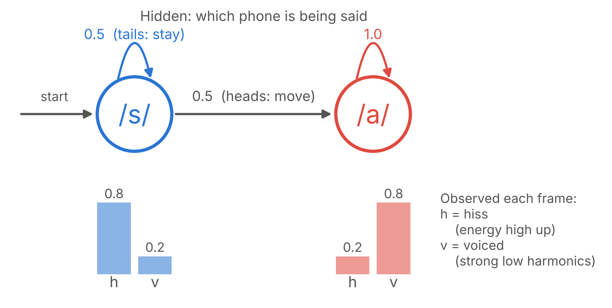

**The model**: transitions $A$ on the arrows, emissions $B$ in the bars under each state.

= 5">

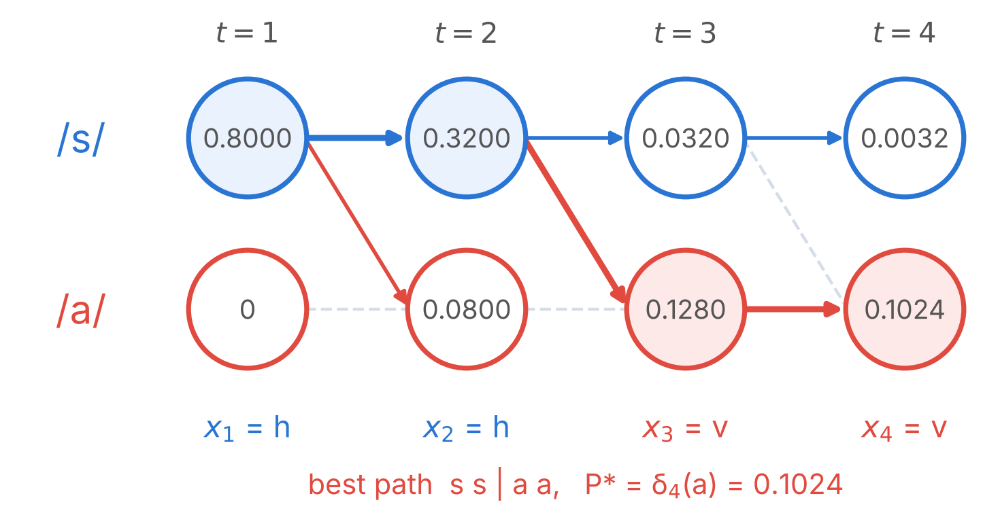

**Backtrace**: a ← a ← s ← s, so **s s | a a**: Practice 1, path a. **Check** the sum: the three alignments that end in /a/ give $0.0512 + 0.1024 + 0.0128 = 0.1664$. The best path carries **62%**.

<!--
Compare with Lecture 4, X = (h, v, h, v): there the v at t = 2 pulled the best path into /a/ after one frame, and the later h was explained as a stray slip from /a/. Here the two h's keep the path in /s/ for two frames.
-->

---
layout: top-title
color: amber-light
align: lt
title: Practice - a new word
---

:: title ::

# Practice 3: A New Word, Three States (10 min)

:: content ::

<v-switch>
<template #0>

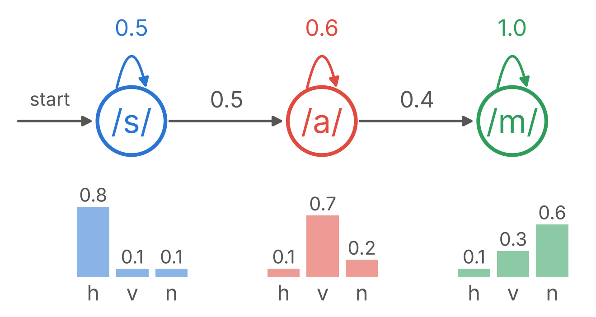

A 3-phone word /s a m/ with three observation symbols: h = hiss, v = vowel, n = nasal hum. $\pi = (1, 0, 0)$. We hear $X = (h, v, n, v)$.

1. **Before computing**: which cells must be 0?
2. **Greedy**: pick the best state per frame. Is that a possible path?
3. Fill the **Viterbi** trellis and backtrace. The word must end in /m/.

</template>
<template #1>

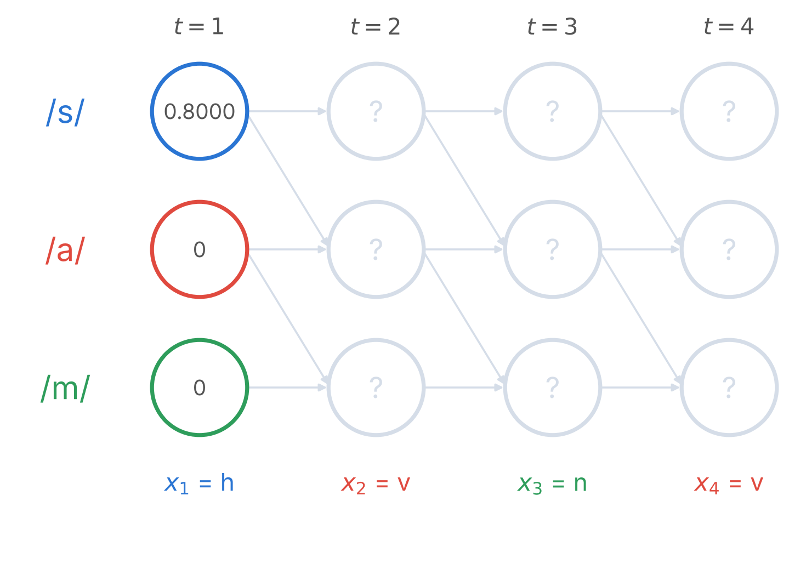

**1.** At $t = 1$ only /s/ is possible ($\pi$). At $t = 2$, /m/ is still 0: it can only be entered from /a/, which was 0 at $t = 1$. Every state needs **at least one frame**.

**2.** Greedy gives **s a m a**: it needs /m/ → /a/, probability 0. **Not a path.**

</template>
<template #2>

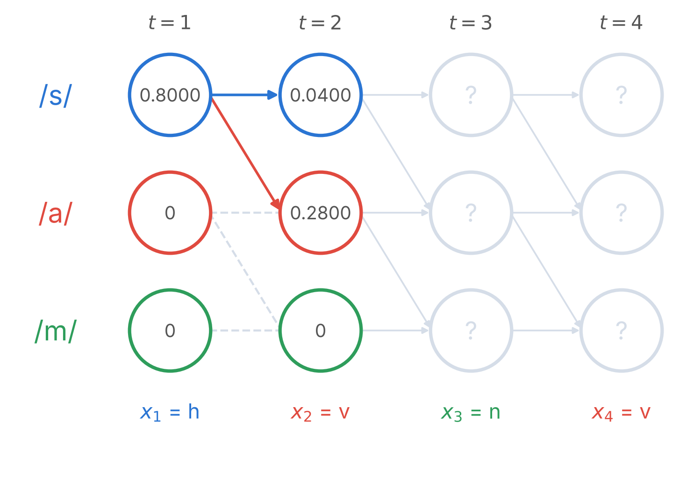

**$t = 2$** ($x_2 = v$):

$\delta_2(s) = 0.8 \cdot 0.5 \cdot 0.1 = 0.04$

$\delta_2(a) = 0.8 \cdot 0.5 \cdot 0.7 = 0.28$

$\delta_2(m) = 0$

</template>
<template #3>

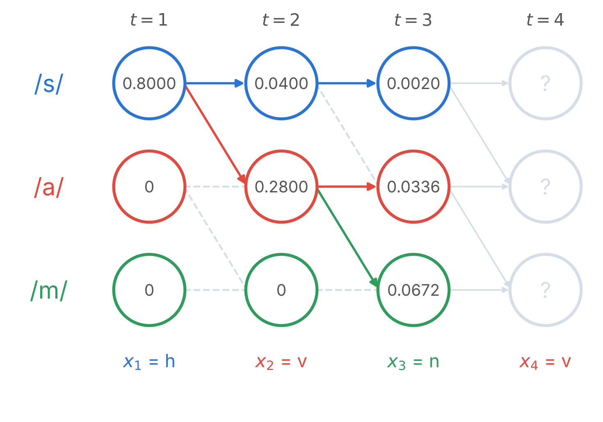

**$t = 3$** ($x_3 = n$):

$\delta_3(s) = 0.04 \cdot 0.5 \cdot 0.1 = 0.002$

$\delta_3(a) = \max(0.04 \cdot 0.5,\ 0.28 \cdot 0.6) \cdot 0.2 = 0.0336$, from /a/

$\delta_3(m) = \max(0.28 \cdot 0.4,\ 0 \cdot 1) \cdot 0.6 = 0.0672$, from /a/

</template>
<template #4>

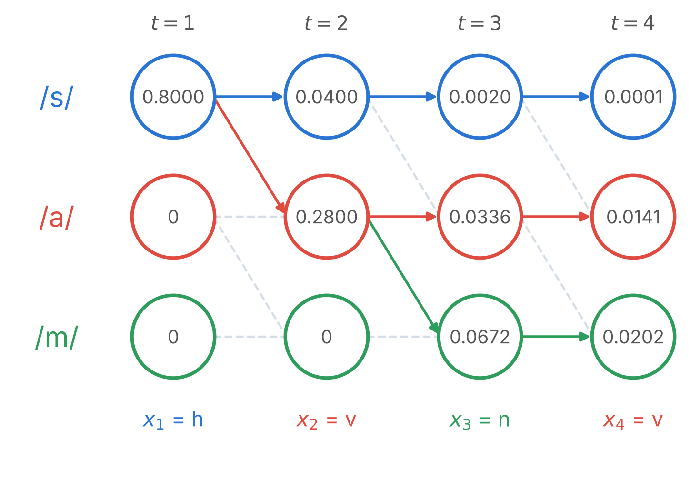

**$t = 4$** ($x_4 = v$, which favours /a/: 0.7 vs 0.3):

$\delta_4(s) = 0.002 \cdot 0.5 \cdot 0.1 = 0.0001$

$\delta_4(a) = \max(0.002 \cdot 0.5,\ 0.0336 \cdot 0.6) \cdot 0.7 = 0.0141$, from /a/

$\delta_4(m) = \max(0.0336 \cdot 0.4,\ 0.0672 \cdot 1) \cdot 0.3 = 0.0202$, from /m/

**Hands up**: which cell is the answer, and why not the larger emission?

</template>
<template #5>

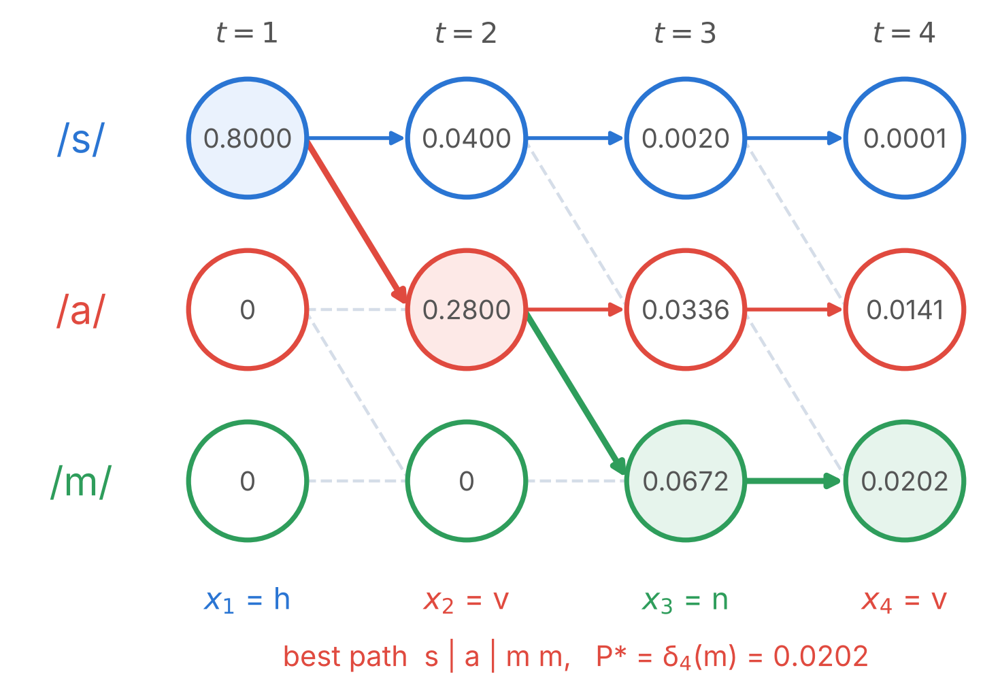

The word must **end in /m/**, so the answer is $\delta_4(m)$, even though /a/ fits the last frame better. Backtrace: $\psi_4(m) = m$, $\psi_3(m) = a$, $\psi_2(a) = s$.

**s | a | m m**, $P^* \approx 0.0202$. The last v is explained as a weak emission of /m/: there is no way back to /a/.

</template>
</v-switch>

<!--
Give the pairs 2 minutes for questions 1 and 2, then 6 minutes for the trellis. Reveal one column at a time and ask a pair to read its number before clicking.
-->

---
layout: top-title
color: amber-light
align: lt
title: Activity - sum or max
---

:: title ::

# Activity 7: Sum or Max? (2 min)

:: content ::

**Stand up for Max** (Viterbi). **Stay seated for Sum** (forward).

<ol>
<li v-click="1">How well does the word <em>salaam</em> fit this audio? Sum: the total over all alignments.</li>
<li v-click="3">Where does each phone start and end? Max: forced alignment.</li>
<li v-click="5">Frame labels to train the hybrid network. Max: forced alignment again.</li>
<li v-click="7">The fastest decoder, in log space, with no logsumexp. Max.</li>
<li v-click="9">Compare two words whose probability is spread over many alignments. Sum: ranking by the best path can pick the wrong word (Activity 4).</li>
<li v-click="11">Bonus: a trellis with only one path of non-zero probability. Both: sum = max.</li>
</ol>

---
layout: section
title: GMMs by hand
---

# Part 2

## GMMs by Hand

Human k-means, Gaussian scores, shares, EM, and training the GMM-HMM

---
layout: top-title
color: amber-light
align: lt
title: Activity - human k-means
---

:: title ::

# Activity 6: Human k-means (6 min)

:: content ::

Ten volunteers hold the cards **1 2 3 4 5 6 12 13 14 15** and stand under their number on the board. Two more volunteers are the **centres**: blue starts at **1**, red at **4**. Then repeat until nobody switches:

1. **Assign**: every card-holder joins the **nearer** centre.
2. **Update**: each group calls out its **average**, and its centre walks there.

<v-click>

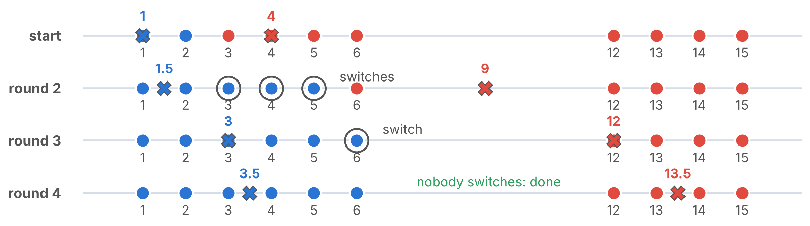

Cards 3, 4 and 5 switch in round 2, card **6** switches last, and the centres stop at **3.5** and **13.5**. This is **k-means**: every card belongs 100% to one group. Later today it returns as the hard version of **EM**.

</v-click>

---
layout: top-title
color: light
align: lt
title: GMM toolkit
---

:: title ::

# Recap: Scoring a Frame with Gaussians

:: content ::

**One bump**: measure the distance in σ units, then turn it into a height:

$$z = \frac{x - \mu}{\sigma}, \qquad \mathcal{N}(x;\mu,\sigma) = \frac{1}{\sqrt{2\pi}\,\sigma}\, e^{-z^2/2} \approx \frac{0.4}{\sigma}\, e^{-z^2/2}$$

**A mixture**: add the bumps, each times its weight: $\;p(x) = \sum_m c_m\, \mathcal{N}(x;\mu_m,\sigma_m)$, with $\sum_m c_m = 1$.

**In logs**: $\log \mathcal{N} = -\log(\sqrt{2\pi}\,\sigma) - z^2/2$, with $\log \sqrt{2\pi} \approx 0.92$.

**z-table**, for every practice in Part 2:

| $z$ | 0 | ±0.5 | ±1 | ±1.5 | ±2 | ±2.5 | ±3 | ±4 |
|---|---|---|---|---|---|---|---|---|
| $e^{-z^2/2}$ | 1 | 0.882 | 0.607 | 0.325 | 0.135 | 0.044 | 0.011 | 0.00034 |

---
layout: top-title
color: amber-light
align: lt
title: Practice - which vowel
---

:: title ::

# Practice 4: Which Vowel, Frame by Frame? (5 min)

:: content ::

Activity 5 of Lecture 5 again: /i/ has $\mu = 300$, $\sigma = 50$; /a/ has $\mu = 750$, $\sigma = 100$. Score three new frames with the z-table, and pick the winner for each. If $z$ is off the table, take $e^{-z^2/2} \approx 0$.

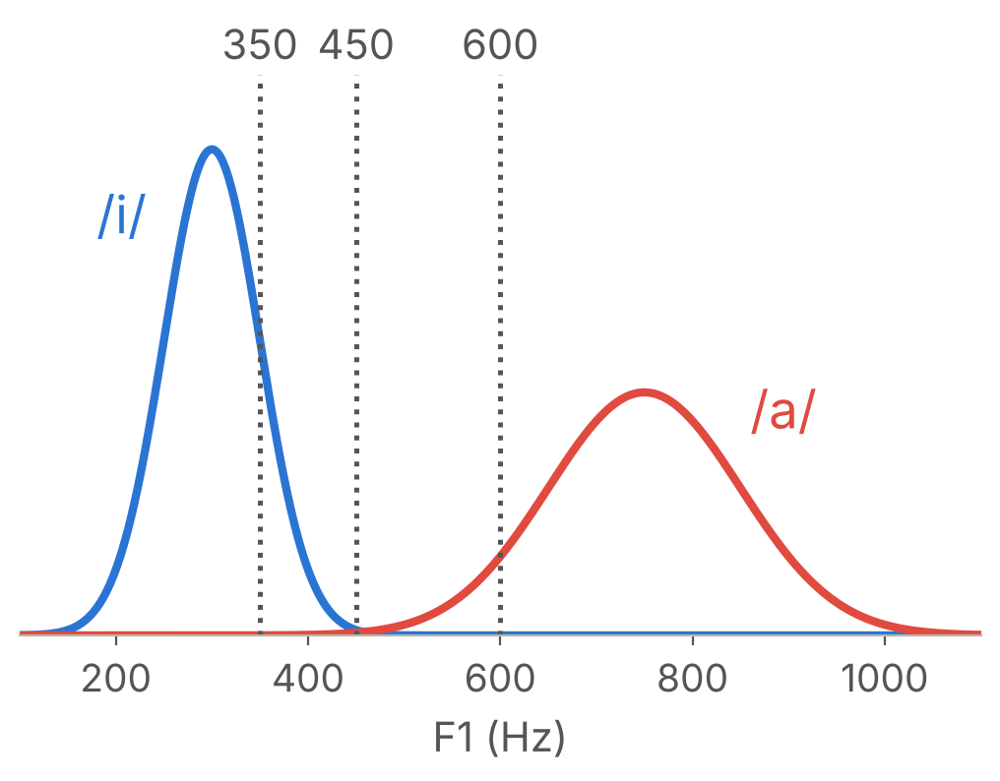

**Peak heights** $0.4/\sigma$: /i/ $= 0.4/50 = 0.008$, /a/ $= 0.4/100 = 0.004$. **Each cell**: find $z$, look up $e^{-z^2/2}$ in the z-table, multiply by the peak.

| F1 | /i/ ($\mu = 300,\ \sigma = 50$) | /a/ ($\mu = 750,\ \sigma = 100$) | wins |
|---|---|---|---|
| 350 | $z = (350-300)/50 = 1$   $0.008 \times 0.607 = 4.9 \times 10^{-3}$ | $z = (350-750)/100 = -4$   $0.004 \times 0.00034 = 1.4 \times 10^{-6}$ | /i/ |
| 450 | $z = (450-300)/50 = 3$   $0.008 \times 0.011 = 8.8 \times 10^{-5}$ | $z = (450-750)/100 = -3$   $0.004 \times 0.011 = 4.4 \times 10^{-5}$ | **/i/, 2×** |
| 600 | $z = (600-300)/50 = 6$   off the table: $\approx 0$ | $z = (600-750)/100 = -1.5$   $0.004 \times 0.325 = 1.3 \times 10^{-3}$ | /a/ |

<v-click>

At 450 Hz both are **3σ** away: the narrower /i/ bump is **taller** ($0.4/50 > 0.4/100$), so /i/ wins.

</v-click>

---
layout: top-title
color: light
align: lt
title: Chicken and egg
---

:: title ::

# Chicken and Egg: the EM Idea

:: content ::

<v-clicks>

- If we knew **which bump each point came from**, we could fit the bumps.
- If we knew **the bumps**, we could tell which bump each point most likely came from.
- We know **neither**. So we **guess** the bumps and then **alternate**:

</v-clicks>

<v-click>

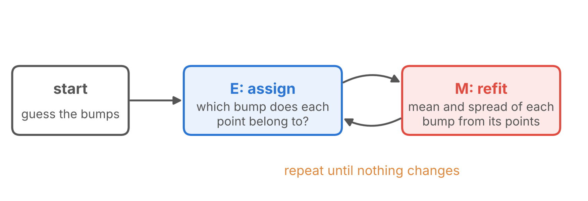

This loop is the **EM** algorithm: **E**xpectation (assign), **M**aximization (refit).

</v-click>

<v-click>

<AdmonitionType type='important'>
Keep this idea in mind: we will meet the same chicken-and-egg problem again.
</AdmonitionType>

</v-click>

---
layout: top-title
color: light
align: lt
title: E-step
---

:: title ::

# EM, Soft Version: the E-step

:: content ::

In Activity 6, card 6 had to join **one** group. The soft version **shares** each point between the bumps, in proportion to their heights at that point:

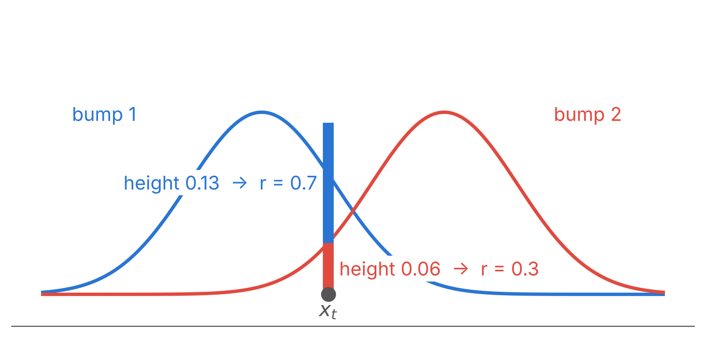

<v-click>

$$r_{tm} = \frac{c_m\, \mathcal{N}(x_t;\mu_m,\sigma_m)}{\sum_k c_k\, \mathcal{N}(x_t;\mu_k,\sigma_k)} \qquad \text{here: } \frac{0.13}{0.13 + 0.06} \approx 0.7$$

$r_{tm}$ is the **responsibility** of bump $m$ for point $x_t$; the shares of each point sum to 1. Watch EM run in <a href="./trellis.html#em" target="_blank"><strong>Trellis Lab</strong></a>.

</v-click>

---
layout: top-title
color: amber-light
align: lt
title: Practice - shares
---

:: title ::

# Practice 5: Two Bumps, One Frame (4 min)

:: content ::

**The E-step on single frames.** A 2-bump mixture for /a/: men $c = 0.6$, $\mu = 700$; children $c = 0.4$, $\mu = 1000$; both $\sigma = 100$. For **x = 800** and **x = 850**, find $p(x)$ and the share of the men's bump.

<v-click>

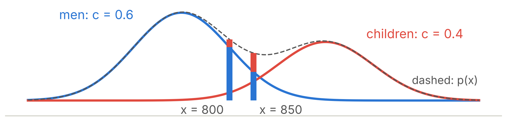

| $x$ | men: $0.6 \cdot 0.004\, e^{-z^2/2}$ | children: $0.4 \cdot 0.004\, e^{-z^2/2}$ | $p(x)$ | $r_\text{men}$ |
|---|---|---|---|---|
| 800 | $z = 1$: $1.46 \times 10^{-3}$ | $z = -2$: $0.22 \times 10^{-3}$ | $1.67 \times 10^{-3}$ | **0.87** |
| 850 | $z = 1.5$: $0.78 \times 10^{-3}$ | $z = -1.5$: $0.52 \times 10^{-3}$ | $1.30 \times 10^{-3}$ | **0.60** |

</v-click>

<v-click>

At 850 the frame is 1.5σ from both bumps, and both bumps have the same σ, so the shares are just the **weights** $c_m$. The shares of one frame add to 1 over the **bumps**, not over the frames.

</v-click>

---
layout: top-title
color: light
align: lt
title: M-step
---

:: title ::

# EM, Soft Version: the M-step

:: content ::

The same two averages as for one bump, but every point now counts with its share $r_{tm}$ instead of 0 or 1:

<v-clicks>

- **Centre**: $\displaystyle \mu_m = \frac{\sum_t r_{tm}\, x_t}{\sum_t r_{tm}}$, the weighted average of the points.
- **Spread**: $\displaystyle \sigma_m^2 = \frac{\sum_t r_{tm}\,(x_t - \mu_m)^2}{\sum_t r_{tm}}$, the weighted average squared distance.
- **Weight**: $\displaystyle c_m = \frac{1}{T}\sum_t r_{tm}$, the share of all the points that bump $m$ takes.

</v-clicks>

<v-click>

<AdmonitionType type='tip'>
If every share is exactly 0 or 1, the centre update is exactly what the human k-means did in Activity 6.
</AdmonitionType>

</v-click>

---
layout: top-title
color: amber-light
align: lt
title: Practice - one EM step
---

:: title ::

# Practice 6: One EM Step by Hand (8 min)

:: content ::

<v-switch>
<template #0>

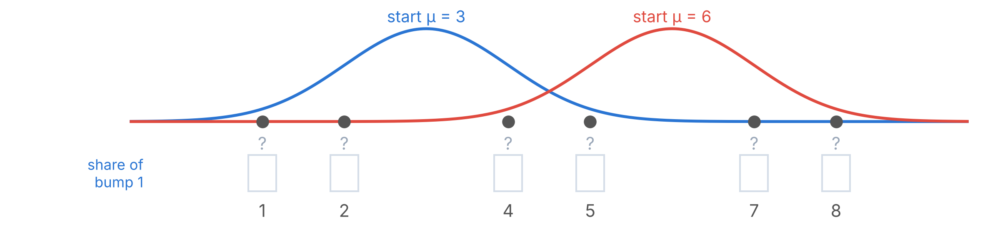

Six points: **1, 2, 4, 5, 7, 8**. Two bumps start at $\mu = (3, 6)$. To keep it short, $\sigma = 1$ and $c = (0.5, 0.5)$ stay **fixed**: we update only the centres.

1. **E-step** for $x = 4$: its share of bump 1. (Equal σ and $c$ cancel, so only $e^{-z^2/2}$ matters.) Then guess the shares of 5, of 1 and 2, and of 7 and 8 without computing.
2. **M-step**: the new $\mu_1$ and $\mu_2$.
3. Compare with **hard** EM (k-means), where 4 and 5 each go 100% to the nearer centre.

</template>
<template #1>

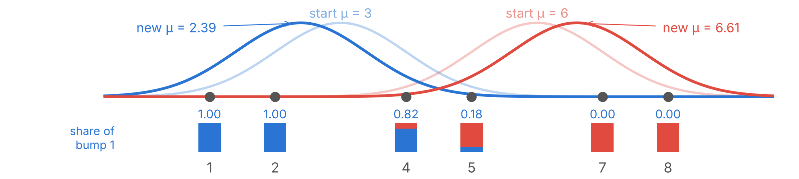

**1. E-step**: 4 is $1\sigma$ from bump 1 and $2\sigma$ from bump 2, so $r = 0.607 / (0.607 + 0.135) = 0.82$. By symmetry 5 gets 0.18; 1 and 2 get $\approx 1$; 7 and 8 get $\approx 0$.

**2. M-step**: weighted averages, each bump with its own shares:

$$\mu_1 = \frac{1 + 2 + 0.82 \cdot 4 + 0.18 \cdot 5}{1 + 1 + 0.82 + 0.18} = \frac{7.18}{3} = 2.39 \qquad \mu_2 = \frac{0.18 \cdot 4 + 0.82 \cdot 5 + 7 + 8}{3} = \frac{19.82}{3} = 6.61$$

**3. Hard EM**: 4 → bump 1 and 5 → bump 2, so $\mu = (7/3,\ 20/3) = (2.33,\ 6.67)$. Soft EM moves the centres less, because 4 and 5 are shared.

</template>
</v-switch>

<!--
Common slips: dividing mu_1 by 6 (the number of points) instead of by the sum of the shares (3); forgetting that point 5 also contributes to bump 1 with 0.18.
-->

---
layout: top-title-two-cols
color: light
columns: is-6
align: l-lt-cm
title: 39 dimensions
---

:: title ::

# From 1 Feature to 39

:: left ::

A real frame has **39 numbers**, not one.

<v-clicks>

- Simplest assumption: **inside each bump**, the 39 numbers are **independent**.
- Then each 39-D bump is just a **product** of 39 one-dimensional Gaussians, each with its own $\mu_d$ and $\sigma_d$:

$$\mathcal{N}(x_t) = \prod_{d=1}^{39} \mathcal{N}(x_{t,d};\ \mu_d, \sigma_d)$$

- Per bump: 39 means and 39 variances, a **diagonal covariance**. A mixture of many such bumps can still follow correlated data.

</v-clicks>

:: right ::

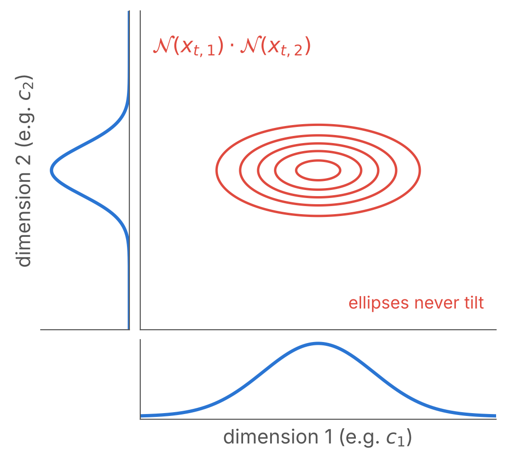

---
layout: top-title
color: light
align: lt
title: GMM in the HMM
---

:: title ::

# Back into the HMM

:: content ::

Each HMM state $j$ gets its **own** mixture:

$$b_j(x_t) = \sum_{m=1}^{M} c_{jm}\, \mathcal{N}(x_t;\mu_{jm},\sigma_{jm})$$

The same chicken-and-egg, one level up: we don't know which **state** produced each frame. So we start from an even split, then alternate:

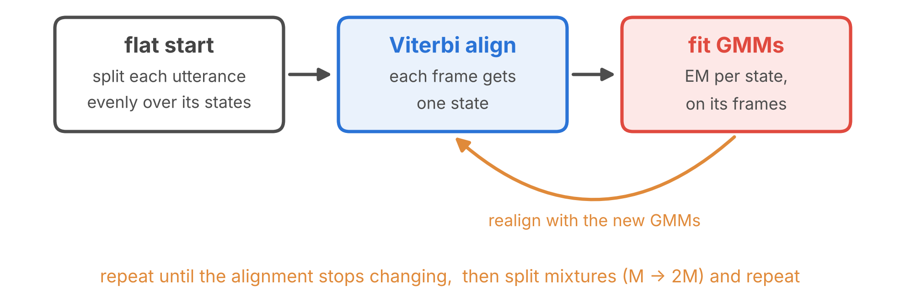

<AdmonitionType type='note'>
This is <strong>Viterbi training</strong> (hard). The soft version, with shares from the forward pass plus a backward pass, is <strong>Baum–Welch</strong>: Rabiner (1989), Problem 3.
</AdmonitionType>

---
layout: top-title
color: amber-light
align: lt
title: Practice - Viterbi training
---

:: title ::

# Practice 8: Train a GMM-HMM by Hand (10 min)

:: content ::

<v-switch>
<template #0>

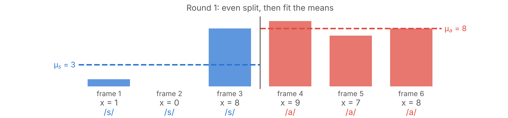

Six frames of /s a/ with one made-up feature, **voicing** (0 = none, 9 = strong). One Gaussian per state, same $\sigma$ for both, so a frame simply goes to the state whose **mean is nearer**, just like human k-means.

**Step 1, flat start**: split evenly, 3 frames each. Compute the two means. Then **step 2**: which frame should change state?

</template>
<template #1>

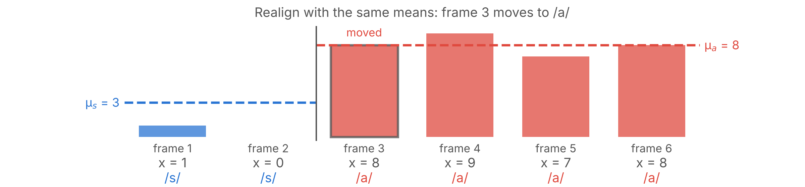

**Means**: $\mu_s = (1 + 0 + 8)/3 = 3$, $\;\mu_a = (9 + 7 + 8)/3 = 8$.

**Realign**: frame 3 has $x = 8$. Its distance to $\mu_s$ is 5, to $\mu_a$ is 0, so it **moves to /a/**. Every other frame is already nearer its own mean.

</template>
<template #2>

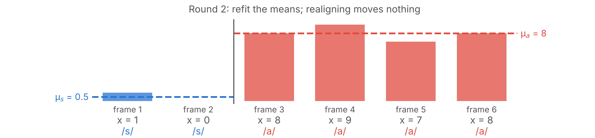

**Refit**: $\mu_s = (1 + 0)/2 = 0.5$, $\;\mu_a = (8 + 9 + 7 + 8)/4 = 8$. **Realign**: nothing moves, so we stop.

- That is the whole loop: **align → refit the means → align again**, until nothing moves.
- One wrong frame in the even split pulled $\mu_s$ up to 3; one round fixed it.

</template>
</v-switch>

---
layout: section
title: Putting it together
---

# Part 3

## Putting It Together

The GMM-HMM and its limits

---
layout: top-title
color: light
align: lt
title: Limits
---

:: title ::

# Why the GMM Is the Weak Link

:: content ::

| The GMM … | A neural network … |
|---|---|
| scores **one frame** at a time | reads a **window of frames** around it |
| needs **MFCCs**, hand-made features, so that diagonal Gaussians fit | **learns its own features** from log-mel |
| fits each state on **its own frames only**, so it never learns what tells /s/ from /a/ | is trained to **tell the states apart** |

The HMM and Viterbi can stay: the first step replaces only the scoring (next slide).

---
layout: top-title
color: light
align: lt
title: Hybrid
---

:: title ::

# The Bridge to Neural ASR: the Hybrid DNN-HMM

:: content ::

Keep the HMM and Viterbi. Replace **only the GMM** with a neural network that reads the frame and outputs a probability for each state.

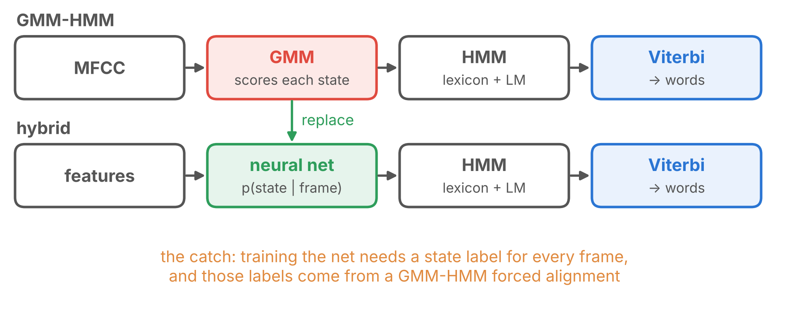

<v-click>

<AdmonitionType type='important'>
Can we train on (audio, transcript) pairs directly, and never fix an alignment? That is <strong>CTC</strong>: next lecture.
</AdmonitionType>

</v-click>

---
layout: top-title
color: amber-light
align: lt
title: Practice - exam-style
---

:: title ::

# Practice 9: Exam-Style Problem (10 min)

:: content ::

A 2-state word /s/ → /a/: $\pi = (1, 0)$, $a_{ss} = 0.5$, $a_{sa} = 0.5$, $a_{aa} = 1$. Each state emits **one Gaussian** with $\sigma = 1$: /s/ has $\mu = 0$, /a/ has $\mu = 4$. We observe $X = (0, 2, 4)$.

**a.** All six $b_j(x_t)$, with the z-table and $1/\sqrt{2\pi} \approx 0.4$. &nbsp; **b.** $P(X \mid \lambda)$ with forward (the word ends in /a/). &nbsp; **c.** The best path with Viterbi. &nbsp; **d.** Without any table: why is $b_s(2) = b_a(2)$, and what decides frame 2?

<v-switch>
<template #1>

**a.** $b_s = (0.4,\ 0.054,\ 0.0001)$ and $b_a = (0.0001,\ 0.054,\ 0.4)$: $z = 0$ gives 0.4, $z = \pm 2$ gives $0.4 \cdot 0.135$, $z = \pm 4$ is almost 0.

**b.** $\alpha_1 = (0.4,\ 0)$; $\;\alpha_2(s) = 0.4 \cdot 0.5 \cdot 0.054 = 0.0108$, $\;\alpha_2(a) = 0.4 \cdot 0.5 \cdot 0.054 = 0.0108$; 
$\alpha_3(a) = (0.0108 \cdot 0.5 + 0.0108 \cdot 1) \cdot 0.4 = \mathbf{0.0065}$

</template>
<template #2>

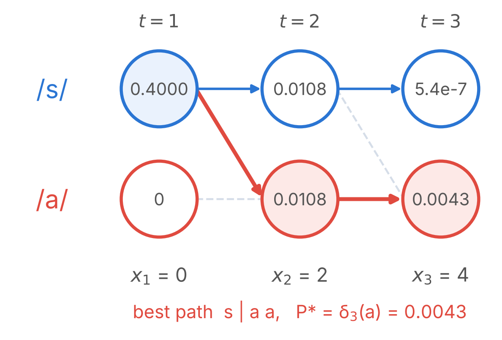

**c.** $\delta_3(a) = \max(0.0108 \cdot 0.5,\ 0.0108 \cdot 1) \cdot 0.4 = 0.0043$, from /a/: **s | a a**.

**d.** Frame 2 is $2\sigma$ from both centres, and the σ's are equal, so the emissions tie. The **transitions** break the tie: from /a/ the next step is free ($a_{aa} = 1$), from /s/ it still costs $a_{sa} = 0.5$. The path s s | a is half as likely (0.0022).

</template>
</v-switch>

---
layout: top-title
color: amber-light
align: lt
title: Practice - true or false
---

:: title ::

# Practice 10: True or False? (5 min)

:: content ::

**Stand up for True. Stay seated for False.**

<ol>
<li v-click="1">A Gaussian density can be larger than 1. True: the peak is 0.4/σ, so σ = 0.1 gives 4. It is a density, not a probability.</li>
<li v-click="3">In the same cell, δ can be larger than α. False: δ is one term of the sum that makes α.</li>
<li v-click="5">The most likely state of each frame, taken alone, gives the Viterbi path. False: it ignores the transitions (s a m a in Practice 3).</li>
<li v-click="7">The shares <em>r</em> of one frame add up to 1. True: over the bumps. Over the frames they add up to how many points the bump "owns".</li>
<li v-click="9">In the M-step, the weight <em>c</em> is the bump's total share divided by the number of bumps. False: divided by <em>T</em>, the number of points.</li>
<li v-click="11">Diagonal Gaussians cannot model correlated features. False: one diagonal bump cannot, but a mixture of several can follow the correlation.</li>
<li v-click="13">Viterbi training and Baum–Welch differ only in hard vs. soft frame shares. True: best path vs. all paths, the same max vs. sum as in Part 1.</li>
</ol>

---
layout: top-title
color: light
align: lt
title: Summary
---

:: title ::

# What to Take Away

:: content ::

- **Viterbi** is the forward algorithm with max instead of sum, plus backpointers. It finds the best alignment in $O(N^2T)$, needs no logsumexp, and with a known transcript gives **forced alignment**.
- A **GMM** scores a continuous frame: Gaussians measure distance in σ units, mixtures handle several groups, and **EM** fits them by alternating assignment and refitting. With a diagonal covariance, each 39-D bump is a product of 39 one-dimensional Gaussians.
- A **GMM-HMM** is trained by alternating Viterbi alignment and GMM fitting. Its assumptions motivate the neural models in the rest of the course.

Next lecture: **CTC**, training on (audio, transcript) pairs without a fixed alignment.

<AdmonitionType type='important'>
Reading: Rabiner (1989), Problems 2 and 3 and the section on continuous mixture densities.
</AdmonitionType>

---
layout: section
title: Questions
class: text-center
---

# Learn More

[Course Homepage](https://github.com/m-fakhry/DSAI-456-Speech) · [Rabiner (1989): A Tutorial on Hidden Markov Models](https://ieeexplore.ieee.org/document/18626) · [J&M: Appendix A, Hidden Markov Models](https://web.stanford.edu/~jurafsky/slp3/A.pdf) · [scikit-learn: Gaussian mixture models](https://scikit-learn.org/stable/modules/mixture.html) · [Montreal Forced Aligner](https://montreal-forced-aligner.readthedocs.io) · [hmmlearn](https://hmmlearn.readthedocs.io)
